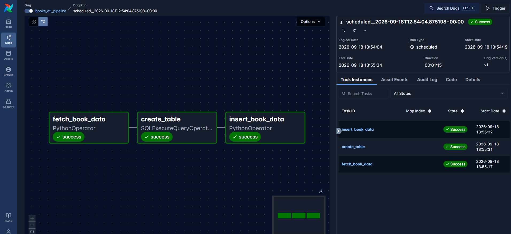
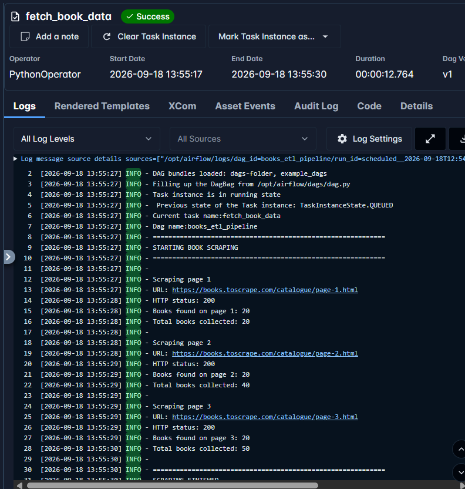
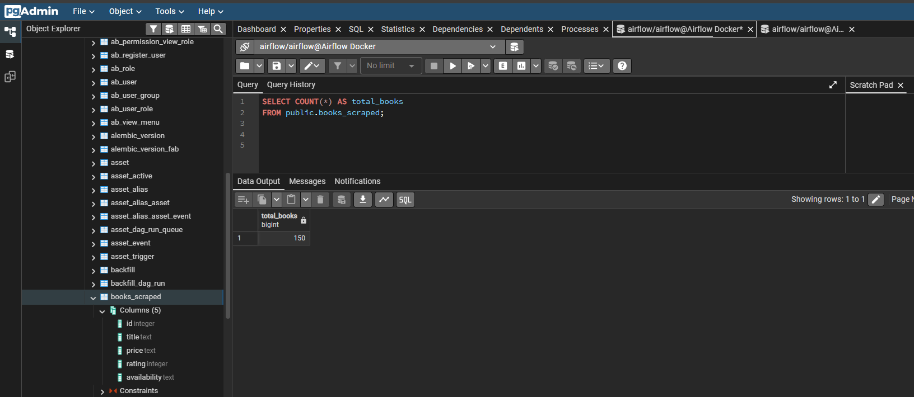
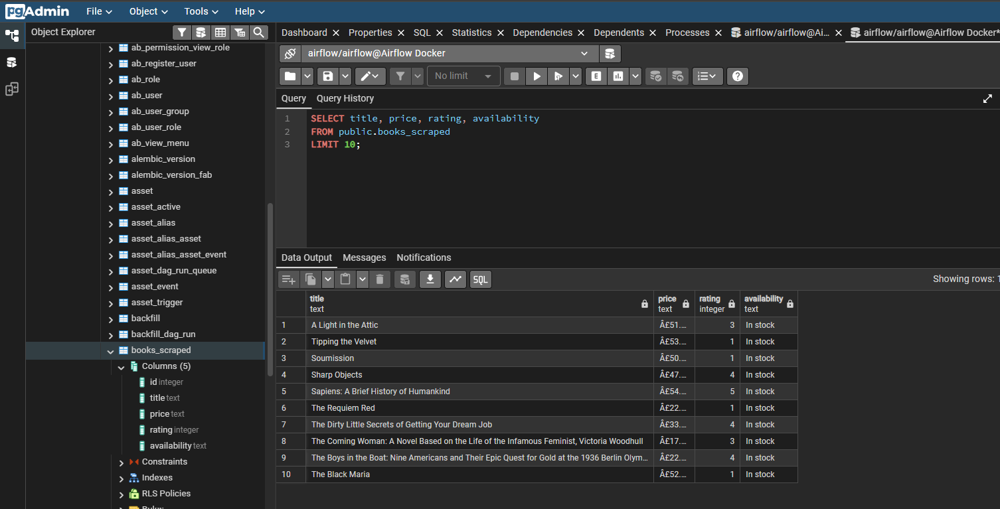
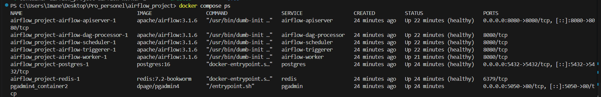

# Books ETL Pipeline

Projet personnel de Data Engineering : collecte, transformation et stockage de donnees de livres avec Apache Airflow.

## Objectif

Le pipeline recupere des livres depuis [Books to Scrape](https://books.toscrape.com/), extrait leur titre, prix, note et disponibilite, puis enregistre les resultats dans PostgreSQL.

## Fonctionnement

Le workflow Airflow `books_etl_pipeline` execute les etapes suivantes dans l'ordre :

1. Recuperation de 50 livres depuis le site web.
2. Nettoyage des donnees et suppression des doublons.
3. Creation automatique de la table `books_scraped`.
4. Insertion des donnees dans PostgreSQL.

Le workflow est planifie quotidiennement et peut aussi etre lance manuellement depuis Airflow.

## Technologies

Python, Apache Airflow, Docker, Docker Compose, PostgreSQL, Redis, Pandas, BeautifulSoup et SQL.

## Resultat

Le pipeline a ete execute avec succes. Les donnees sont stockees dans PostgreSQL dans la table `books_scraped`.

Les captures ci-dessous montrent le fonctionnement reel du projet :

## Captures d'ecran

### Execution du DAG Airflow

Les trois taches du workflow sont terminees avec succes.

### Logs de collecte

Les logs montrent que le site repond correctement et que 50 livres ont ete collectes.

### Resultats PostgreSQL

La table contient les livres recuperes avec leur titre, prix, note et disponibilite.

### Services Docker

Les conteneurs Airflow, PostgreSQL et Redis sont actifs.

## Valeur du projet

Ce projet montre la mise en place d'un pipeline ETL complet, l'orchestration de taches dependantes avec Airflow, l'utilisation de Docker pour l'environnement technique et le stockage de donnees dans une base relationnelle.
